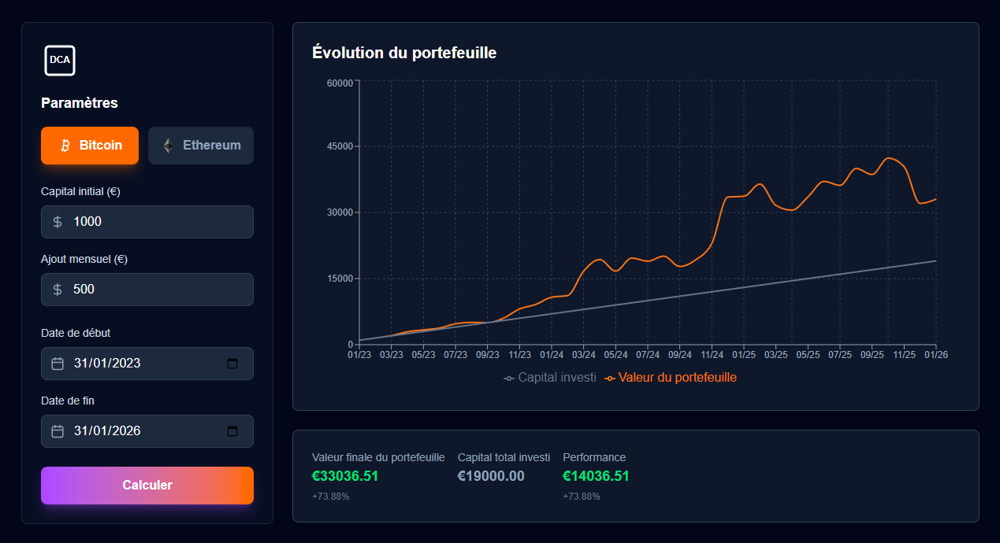

# DCA Crypto Calculator

[](https://opensource.org/licenses/MIT)

A web application for simulating Dollar Cost Averaging (DCA) in euros for Bitcoin, Ethereum, XRP and Solana.

## Features

- **Interactive DCA Simulation**: Calculate and visualize investment returns using Dollar Cost Averaging
- **Multi-Cryptocurrency Support**: Analyze strategies for Bitcoin, Ethereum, XRP and Solana
- **Historical Data**: Uses real market data from the past years for accurate simulations
- **Responsive Design**: Clean, dark-themed interface that works on all devices
- **Real-time Charts**: Visualize your investment growth over time with interactive charts

## Tech Stack

- **Framework**: Next.js 16 (App Router)
- **Styling**: Tailwind CSS
- **Charts**: Recharts
- **Icons**: Lucide React
- **Prices**: Local SQLite for development and Turso (libSQL) on Vercel. The calculator reads stored daily prices.

## Getting Started

1. Clone the repository:
```bash
git clone https://github.com/your-username/dca-crypto-calculator.git
cd dca-crypto-calculator
```

2. Install dependencies with Node.js 24 LTS:
```bash
npm ci
```

3. Import the historical prices:
```bash
npm run prices:import
```

4. Run the development server:
```bash
npm run dev
```

5. Open [http://localhost:3000](http://localhost:3000) in your browser.

## Usage

1. Select your cryptocurrency
2. Set your initial capital amount
3. Define your monthly investment amount
4. Choose your investment period (start and end dates)
5. Click "Calculate" to see your DCA strategy results
6. Review the chart and summary metrics

## Price data

`npm run prices:import` loads the available history and can repair older gaps. `npm run prices:update` fetches completed UTC days missing since the latest stored date and retries gaps within the preceding six days. Both commands report coverage, gaps and price changes greater than fivefold. The app uses the EUR price and stores the USD price and source alongside it. `GET /api/prices` reads the configured database and returns an error if the requested range contains a missing day.

The local database defaults to `data/crypto.db` and can be overridden with `CRYPTO_DB_PATH`. `npm run prices:backup` takes a consistent local SQLite snapshot, including committed changes in the WAL, under `data/backups/` or `CRYPTO_BACKUP_DIR`.

### Deploy on Vercel

1. Run `npm run prices:backup` locally. Use the file path printed by the command to create a [Turso libSQL database from the snapshot](https://docs.turso.tech/cli/db/create). This copies the existing data and its synchronization timestamps.

   ```bash
   turso db create dca-prices --from-file data/backups/crypto-YYYY-MM-DD.db --wait
   ```

   If you already have an empty libSQL database, you can also seed it with `npm run prices:import` from a local shell that has the two Turso variables below set. The npm scripts read environment variables from the calling shell.

2. Set `TURSO_DATABASE_URL`, a read/write `TURSO_AUTH_TOKEN`, and a random `CRON_SECRET` in the Vercel project's Production environment. The database token stays on the server. Preview deployments also need Turso settings if they are expected to display real prices.
3. Deploy and confirm that the calculator shows the imported history. Vercel calls `/api/cron/prices` on the `0 3 * * *` UTC schedule declared in `vercel.json`. On Hobby, the invocation can occur during the 03:00–03:59 UTC window. The cron updates Turso directly and reports results in Vercel runtime logs. [Cron limits](https://vercel.com/docs/schedules/cron-jobs/usage-and-pricing)

Turso provides [point-in-time recovery](https://turso.tech/pricing). To keep a separate export, use `turso db shell dca-prices .dump` and store the result privately. [Turso export documentation](https://docs.turso.tech/local-development)

- [Coin Metrics Community](https://docs.coinmetrics.io/api-reference) and its [historical archives](https://github.com/coinmetrics/data#license) are the primary sources. The free data is licensed for non-commercial use. Historical USD-only records are converted using [ECB reference rates](https://data.ecb.europa.eu/data/datasets/EXR/EXR.D.USD.EUR.SP00.A).
- [Binance Spot](https://developers.binance.com/en/docs/products/spot/rest-api) fills gaps with EUR pairs and provides early SOL history via SOL/BTC converted using the stored BTC prices. Check [Binance terms](https://www.binance.com/en/terms) for the intended use or redistribution.
- The imported series starts where the sources provide usable prices. The sources checked provide XRP from August 2014.

## Screenshots



## Contributing

Contributions are welcome! Please feel free to submit a Pull Request.

## License

The application code is available under the [MIT License](LICENSE).
